<p align="center">
  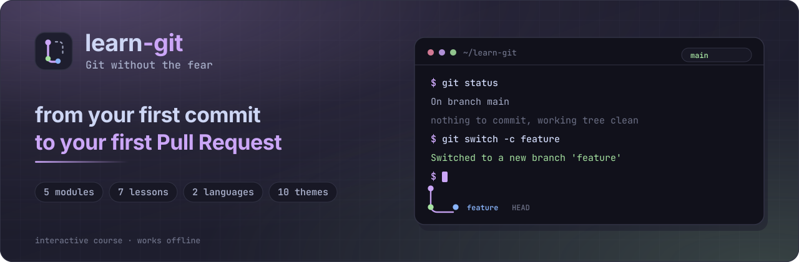
</p>

<h1 align="center">learn-git 🚀</h1>

<p align="center">
  <b>An interactive Git course for absolute beginners.</b><br>
  Plain-language theory, hands-on practice, 10 themes and two languages — fully offline, no CDN.
</p>

<p align="center">
  <a href="README.ru.md"></a>
  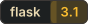
  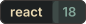
  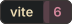
  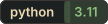
  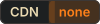
  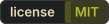
</p>

<p align="center">
  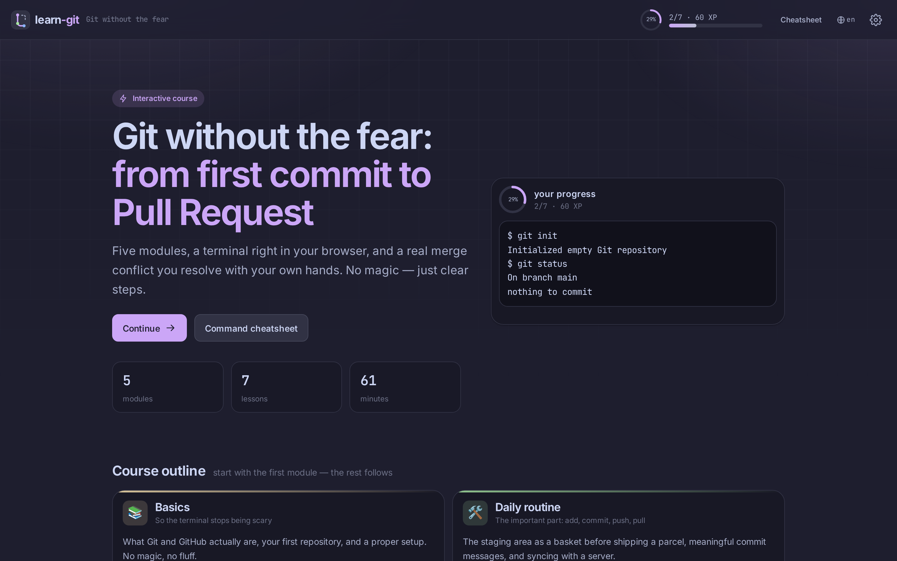
</p>

---

## 🌍 Language selector

| Language | File |
|---|---|
| 🇬🇧 **English** | **you are here** |
| 🇷🇺 **Русский** | **[README.ru.md](README.ru.md)** |

> The app itself speaks **both languages**: the UI picks your browser language on the first visit,
> and you can switch anytime with the 🌐 button in the header or in ⚙️ Settings.

---

## ✨ What it is

A little course site that answers the questions every beginner stumbles over:

- 😵 **“Is Git the same as GitHub?”** — a whole lesson on this mix-up alone.
- 🧺 **“What is the staging area?”** — explained as a basket before shipping a parcel.
- 🌿 **“What is a branch?”** and how to read `git merge` output without panic.
- 💥 **“A merge conflict?!”** — built step by step, then resolved calmly.
- 🔐 **“.env in a repository?”** — `.gitignore`, `stash`, `reset` vs `revert`.
- 🤝 **SSH keys, Pull Requests, forks, code review.**

## 🧩 Features

| | |
|---|---|
| 🎨 **10 themes + your own** | Gruvbox Dark is the default. Catppuccin (Mocha / Macchiato / Frappé / Latte), Ayu (Dark / Mirage / Light), Gruvbox Light, Minimal Dark — plus a built-in editor that lets you build a custom palette from 20 colors and save it in your browser. |
| 🌐 **Two languages** | Russian and English, auto-detected from the browser, switchable in the header and in Settings. Lessons are written twice, not machine-translated. |
| 📈 **Progress that sticks** | Completed lessons, XP and a day streak in `localStorage`, with JSON export/import so a browser cleanup doesn't hurt. |
| 🎉 **Delightful effects** | Confetti, toasts and micro-animations that respect `prefers-reduced-motion` and can be turned off. |
| 📱 **Mobile first** | Drawer navigation, sticky lesson bar, 44px touch targets, safe-area padding for iOS. |
| 📴 **Works offline** | Inter, JetBrains Mono, Noto Color Emoji, `highlight.js` and `canvas-confetti` are installed from npm and bundled — zero requests to a CDN at runtime. |
| 🖥️ **Terminal trainer** | A real fake Git right inside the lesson: `init`, `add`, `commit`, `branch`, `merge` with conflicts, `stash`, `reset`, `revert`, `push`. Output looks like the real thing, and you can break the working tree freely — one click on Reset brings it back. |
| ✅ **Checked exercises** | Every lesson has a quiz with explanations, a checklist and hands-on practice: the trainer inspects the repository state and lights up "solved" once it's done. |
| 🧪 **Tested** | 12 pytest API tests + 39 frontend checks in jsdom (no Chromium needed). |

## 🖼️ Screenshots

<table>
  <tr>
    <td width="50%"><br><sub><b>Home</b> — course outline and progress</sub></td>
    <td width="50%">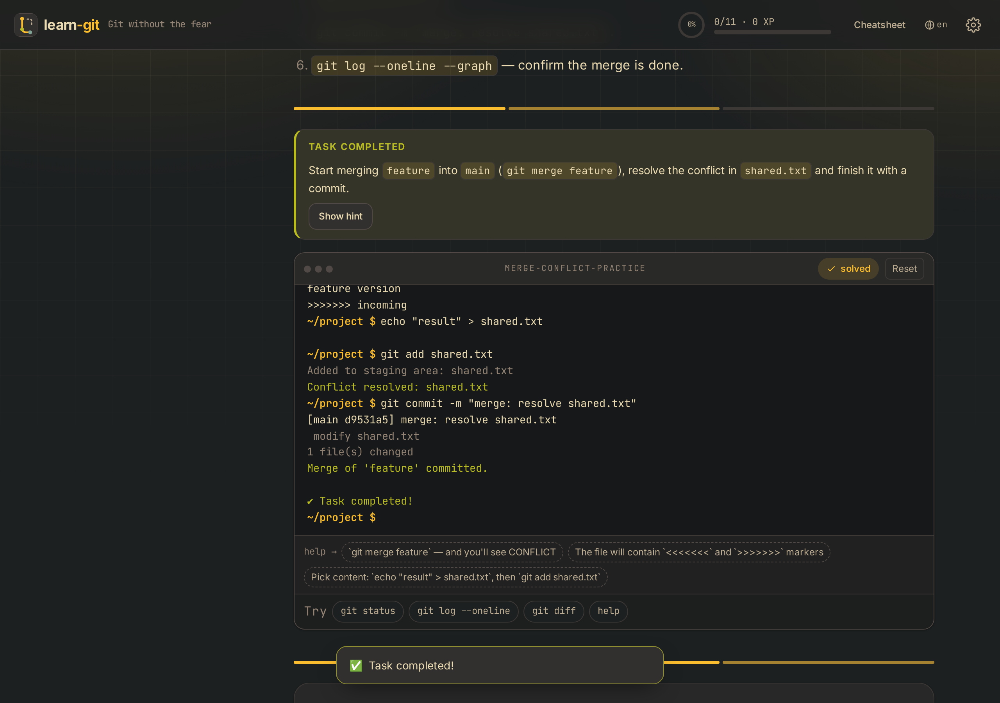<br><sub><b>Trainer</b> — type Git commands, get real output</sub></td>
  </tr>
  <tr>
    <td width="50%">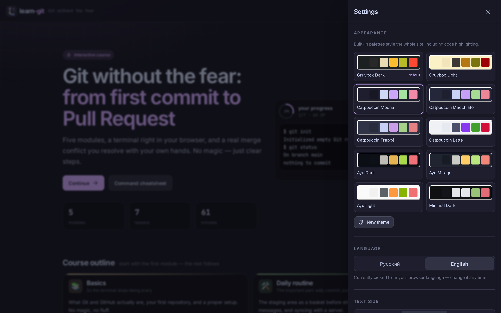<br><sub><b>Settings</b> — 10 themes, language, text size, effects</sub></td>
    <td width="50%">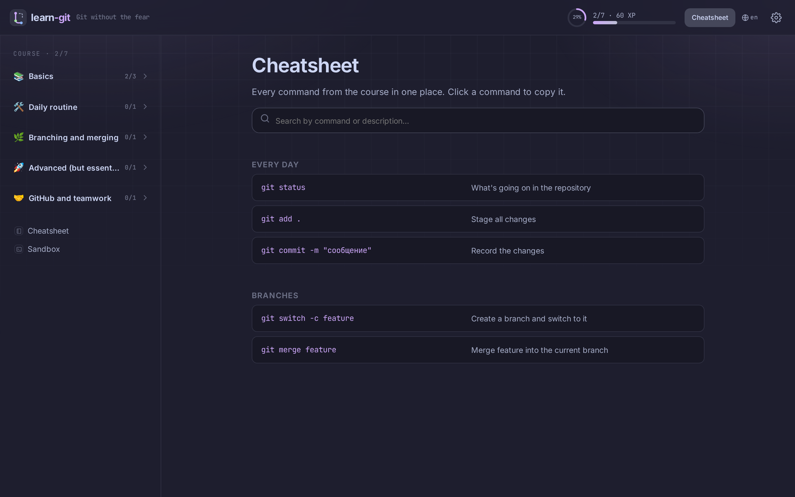<br><sub><b>Cheatsheet</b> — every command, click to copy</sub></td>
  </tr>
</table>

<p align="center">
  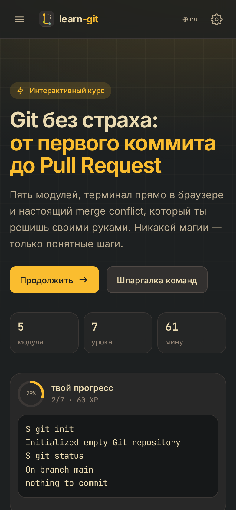
  &nbsp;
  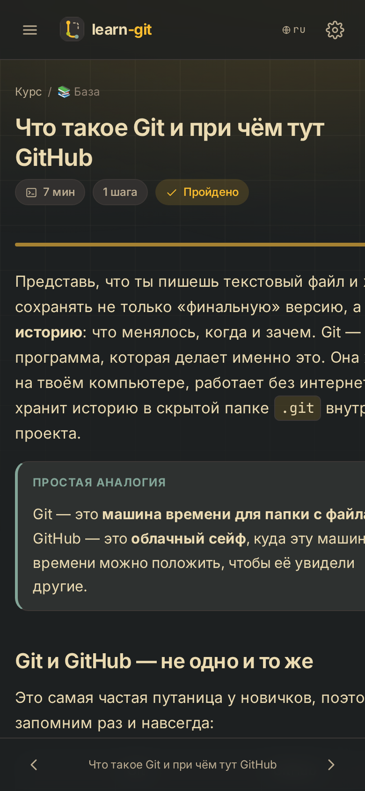
  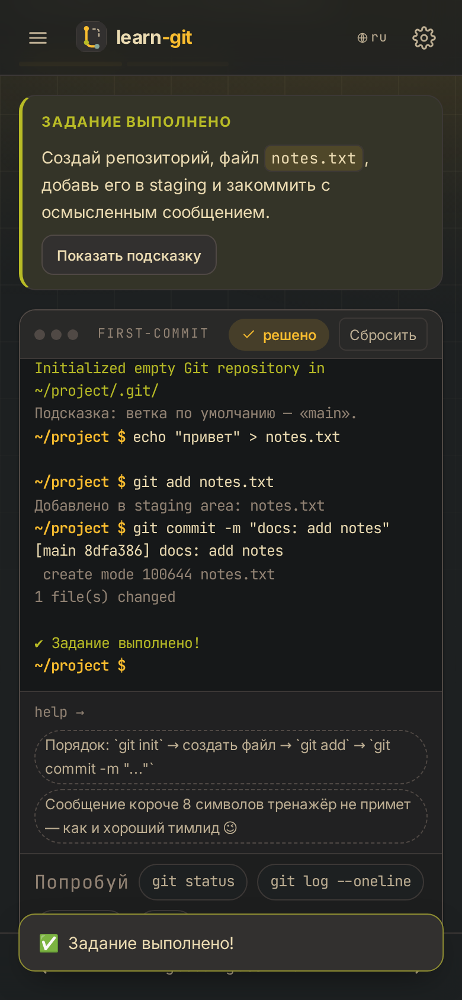
</p>

## 📚 Course outline

| | Module | Lessons |
|---|---|---|
| 📚 | **1. Basics** | 1. What Git is and how it differs from GitHub · 2. Your first repository: `init` and `clone` · 3. `git status` and first-time `config` |
| 🛠️ | **2. Daily routine** | 4. `git add` and `git commit` · 5. `git push` and `git pull` |
| 🌿 | **3. Branching and merging** | 6. Branches: `branch` and `switch` · 7. Merging and a real merge conflict |
| 🚀 | **4. Advanced (but essential)** | 8. `.gitignore` for secrets · 9. `stash`, `reset` and `revert` |
| 🤝 | **5. GitHub and teamwork** | 10. SSH keys · 11. Pull Requests and code review |

Each lesson has theory plus a mix of a quiz with explanations, a habits checklist and
hands-on terminal practice (12 exercises across the course, from `git init` to pushing
a branch and opening a PR).

**All 11 lessons are written in both languages** — 5 modules, ~134 minutes of
reading, 28 cheatsheet commands and 12 trainer exercises. Status and roadmap live in
[`docs/PLAN.md`](docs/PLAN.md).

### 🖥️ Terminal trainer

Each lesson can contain a window where you type real Git commands. Under it, `help`
prints the command list and — **only in some lessons** — a few small hints for that
specific task. Lessons without hints say so honestly and keep the general list.

A task is checked against the state of the virtual repository: "at least one commit",
"`notes.txt` is in history", "no conflicts left", "the push reached `origin`". So you
can solve it your own way — the trainer cares about the result, not the exact command.
The Reset button rewinds everything to the start of the task.

## 🚀 Quick start

```bash
./scripts/start.sh
```

The script creates `.venv`, installs dependencies, builds the frontend and serves everything
at **http://localhost:13444** (`0.0.0.0`).

Manual route:

```bash
# backend
python3 -m venv .venv
./.venv/bin/pip install -r backend/requirements.txt

# frontend
cd frontend && npm install && npm run build && cd ..

# run (0.0.0.0:13444)
./.venv/bin/python backend/run.py
```

Development with hot reload:

```bash
./scripts/start.sh --dev   # Vite on 0.0.0.0:5173 proxies /api to Flask on 13444
```

## 🏗️ How it's built

```
backend/
  app/content.py        # YAML + Markdown → JSON, localization, :::note callouts
  app/routes/api.py     # /api/health, /api/course, /api/lessons/…, /api/cheatsheet
  app/routes/web.py     # serves the built SPA + a “build the frontend” hint
  run.py                # 0.0.0.0:13444
content/
  course.yaml           # modules, lessons, cheatsheet
  modules/01-basics/    # lesson.md (ru) + lesson.en.md (en)
frontend/src/
  styles/tokens.css     # every theme as CSS variables
  settings.jsx          # theme, language, effects, text size
  i18n/{ru,en}.js       # UI dictionaries
  progress.jsx          # localStorage progress
  pages/                # Home, Lesson, Cheatsheet, Sandbox
  sim/git.js            # virtual git: state, commands, conflicts
  sim/checks.js         # task checks declared in course.yaml
  sim/Terminal.jsx      # the trainer window
scripts/
  start.sh              # build + run in one command
  smoke-router.mjs      # 28 frontend checks in jsdom
  make_banner.py        # generates SVG banners (docs/banners) and badges (docs/badges)
docs/
  PLAN.md  banners/  screenshots/
```

One port, one origin: Flask serves the JSON API **and** the built React app, so `/api` never
needs CORS and the preview works through a single tunnel.

## 🎨 Adding a lesson

1. Create `content/modules/<module>/<slug>.md` (plus `<slug>.en.md` for English).
2. Add it to `content/course.yaml`, optionally with `steps` (`theory`, `quiz`, `checklist`, `terminal`).
3. Restart Flask — content is cached in-process.

Callouts in Markdown:

```markdown
:::tip A handy tip
Text of the tip
:::
```

## 🧪 Tests

```bash
# API
cd backend && ../.venv/bin/python -m pytest -q

# frontend (needs Flask running — it dumps API fixtures first)
cd frontend && npm run smoke

# every trainer exercise in course.yaml: solvable, and not solvable by doing nothing
cd frontend && npm run check:tasks
```

## 🖌️ Regenerating the banner

The banner is pure SVG, drawn by code — text is converted to outlines so it renders identically
everywhere and needs no fonts:

```bash
./.venv/bin/pip install fonttools brotli
./.venv/bin/python scripts/make_banner.py
```

The same script draws the local badges in `docs/badges` — no shields.io, no external images.

## 📄 License

MIT — see [LICENSE](LICENSE).

<p align="center">
  <sub>Made with ♥ for everyone who is still afraid of the terminal.</sub><br>
  <sub>🇷🇺 <a href="README.ru.md">Читать по-русски</a></sub>
</p>
