<p align="center">
  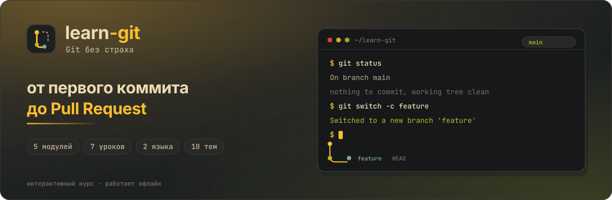
</p>

<h1 align="center">learn-git 🚀</h1>

<p align="center">
  <b>Интерактивный курс по Git для настоящих новичков.</b><br>
  Простая теория, практика руками, 10 тем и два языка — всё офлайн, без CDN.
</p>

<p align="center">
  <a href="README.md"></a>
  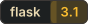
  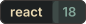
  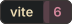
  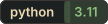
  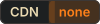
  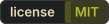
</p>

<p align="center">
  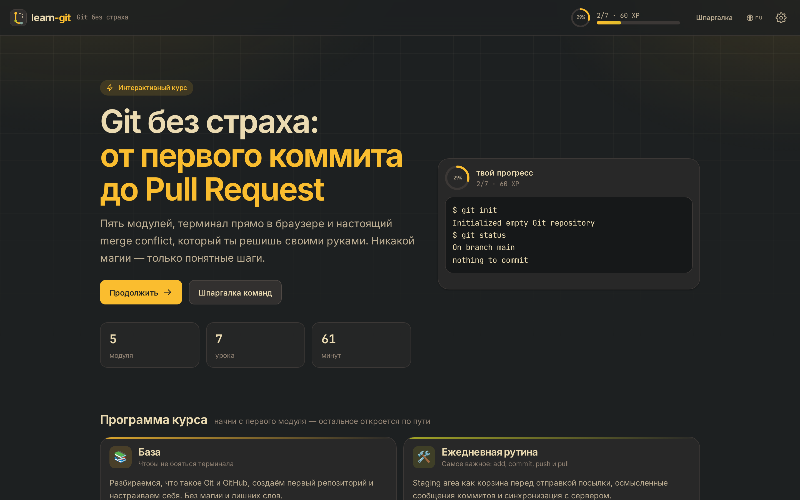
</p>

---

## 🌍 Выбор языка

| Язык | Файл |
|---|---|
| 🇷🇺 **Русский** | **вы здесь** |
| 🇬🇧 **English** | **[README.md](README.md)** |

> Сам сайт говорит **на двух языках**: интерфейс сам подхватывает язык браузера при первом входе,
> а переключить можно в любой момент кнопкой 🌐 в хедере или в ⚙️ настройках.

---

## ✨ Что это

Небольшой сайт-курс, который отвечает на вопросы, обо которые спотыкается каждый новичок:

- 😵 **«Git и GitHub — это одно и то же?»** — на эту путаницу выделен отдельный урок.
- 🧺 **«Что такое staging area?»** — объясняем через корзину перед отправкой посылки.
- 🌿 **«Зачем ветки?»** и как читать вывод `git merge`, не паникуя.
- 💥 **«Merge conflict?!»** — сначала создаём его руками, потом спокойно решаем.
- 🔐 **«.env в репозитории?»** — `.gitignore`, `stash`, `reset` против `revert`.
- 🤝 **SSH-ключи, Pull Request, форки, code review.**

## 🧩 Возможности

| | |
|---|---|
| 🎨 **10 тем + своя** | По умолчанию Gruvbox Dark. Ещё Catppuccin (Mocha / Macchiato / Frappé / Latte), Ayu (Dark / Mirage / Light), Gruvbox Light, Minimal Dark — и встроенный редактор, где из 20 цветов собирается собственная палитра. |
| 🌐 **Два языка** | Русский и английский, автоопределение по браузеру, переключатель в хедере и в настройках. Уроки написаны дважды, а не прогнаны через переводчик. |
| 📈 **Прогресс не теряется** | Пройденные уроки, XP и серия дней в `localStorage`, плюс экспорт/импорт JSON — чтобы чистка браузера не стёрла старания. |
| 🎉 **Приятные эффекты** | Конфетти, тосты и микроанимации. Уважают `prefers-reduced-motion` и отключаются одной кнопкой. |
| 📱 **Сначала мобильные** | Drawer-навигация, липкая панель урока, тач-таргеты 44px, safe-area для iOS. |
| 📴 **Работает офлайн** | Inter, JetBrains Mono, Noto Color Emoji, `highlight.js` и `canvas-confetti` ставятся из npm и попадают в сборку — в рантайме ноль запросов к CDN. |
| 🧪 **С тестами** | 10 pytest-тестов API + 28 проверок фронтенда в jsdom (Chromium не нужен). |

## 🖼️ Скриншоты

<table>
  <tr>
    <td width="50%"><br><sub><b>Главная</b> — программа курса и прогресс</sub></td>
    <td width="50%">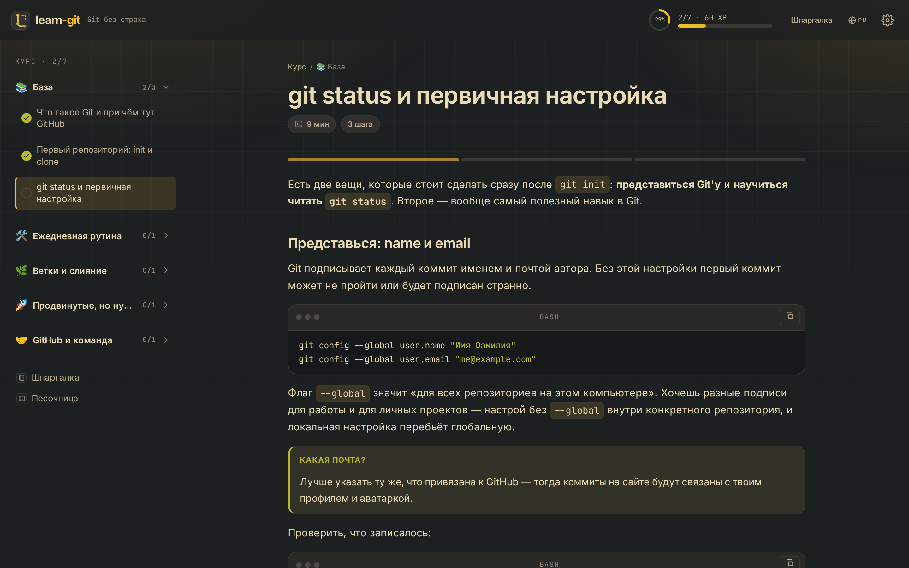<br><sub><b>Урок</b> — теория, подсветка кода, выноски</sub></td>
  </tr>
  <tr>
    <td width="50%">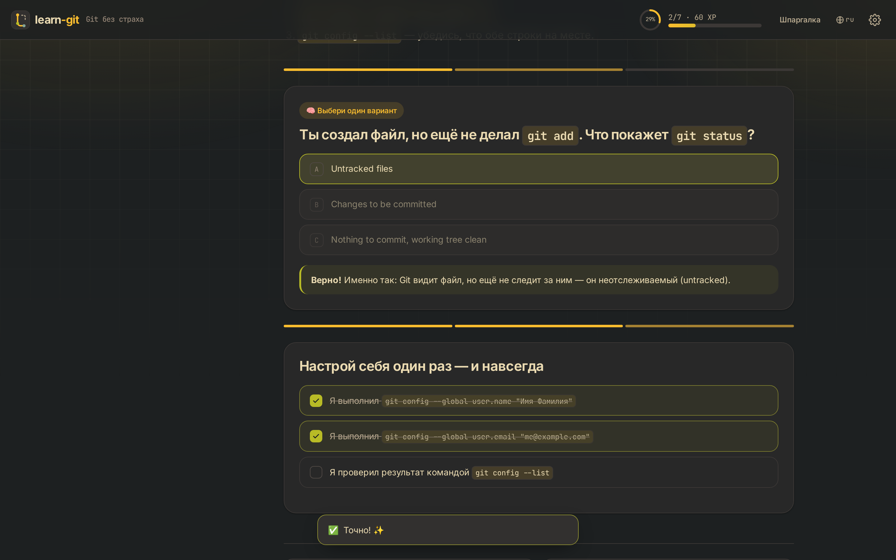<br><sub><b>Практика</b> — квиз с разбором и чек-лист</sub></td>
    <td width="50%">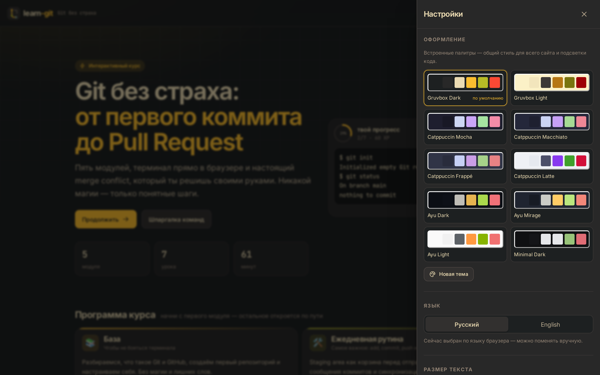<br><sub><b>Настройки</b> — темы, язык, размер текста, эффекты</sub></td>
  </tr>
  <tr>
    <td width="50%">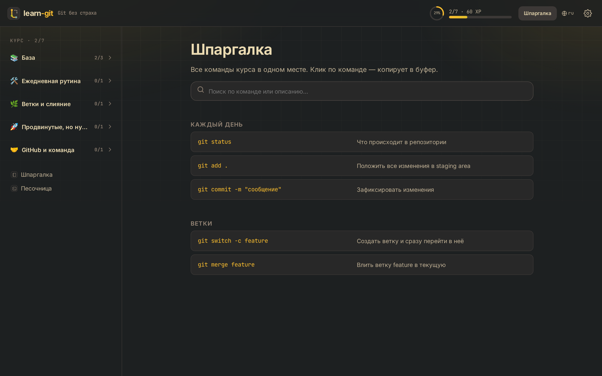<br><sub><b>Шпаргалка</b> — все команды, клик копирует</sub></td>
    <td width="50%">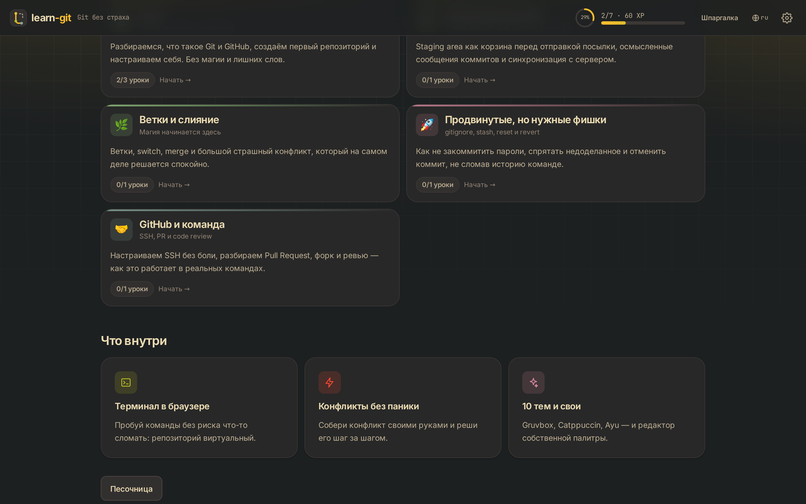<br><sub><b>Модули</b> — 5 штук, от базы до GitHub</sub></td>
  </tr>
</table>

<p align="center">
  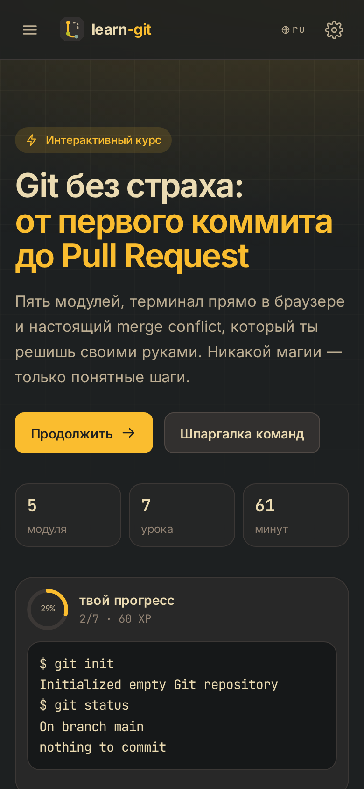
  &nbsp;
  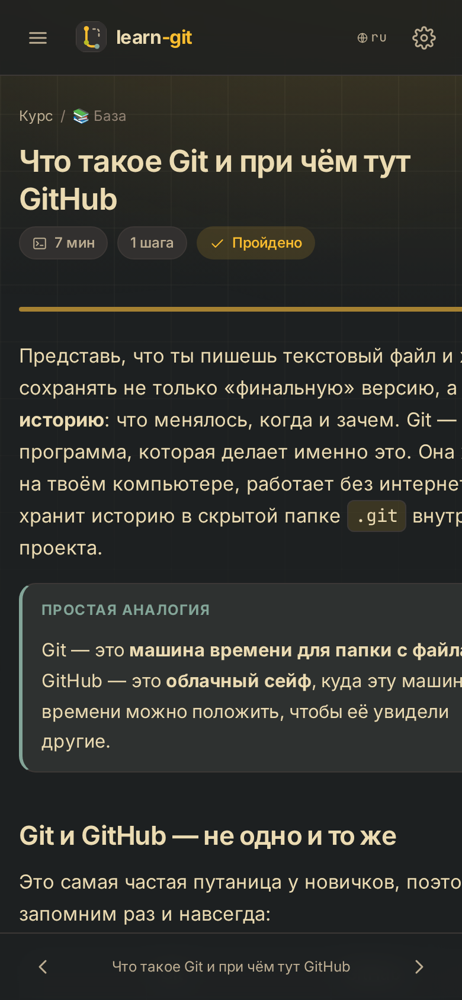
</p>

## 📚 Программа курса

| | Модуль | Что внутри |
|---|---|---|
| 📚 | **1. База** | Git против GitHub, `git init`, `git clone`, `git status`, первичный `git config` |
| 🛠️ | **2. Ежедневная рутина** | Staging area, `git add`, `git commit`, осмысленные сообщения, `push` / `pull` |
| 🌿 | **3. Ветки и слияние** | Зачем ветки, `git branch`, `switch`, `merge` и настоящий merge conflict |
| 🚀 | **4. Продвинутые, но нужные фишки** | `.gitignore` для паролей, `git stash`, `reset --soft/--mixed/--hard`, `revert` |
| 🤝 | **5. GitHub и команда** | SSH-ключи, форки, Pull Request, code review |

Первый модуль написан целиком на двух языках, остальные свёрстаны и ждут текста —
план в [`docs/PLAN.md`](docs/PLAN.md).

## 🚀 Быстрый старт

```bash
./scripts/start.sh
```

Скрипт создаст `.venv`, поставит зависимости, соберёт фронтенд и поднимет всё
на **http://localhost:13444** (`0.0.0.0`).

Вручную:

```bash
# бэкенд
python3 -m venv .venv
./.venv/bin/pip install -r backend/requirements.txt

# фронтенд
cd frontend && npm install && npm run build && cd ..

# запуск (0.0.0.0:13444)
./.venv/bin/python backend/run.py
```

Разработка с горячей перезагрузкой:

```bash
./scripts/start.sh --dev   # Vite на 0.0.0.0:5173 проксирует /api в Flask на 13444
```

## 🏗️ Как устроено

```
backend/
  app/content.py        # YAML + Markdown → JSON, локализация, выноски :::note
  app/routes/api.py     # /api/health, /api/course, /api/lessons/…, /api/cheatsheet
  app/routes/web.py     # отдаёт собранный SPA + подсказку «собери фронтенд»
  run.py                # 0.0.0.0:13444
content/
  course.yaml           # модули, уроки, шпаргалка
  modules/01-basics/    # lesson.md (ru) + lesson.en.md (en)
frontend/src/
  styles/tokens.css     # все темы как CSS-переменные
  settings.jsx          # тема, язык, эффекты, размер текста
  i18n/{ru,en}.js       # словари интерфейса
  progress.jsx          # прогресс в localStorage
  pages/                # Home, Lesson, Cheatsheet, Sandbox
scripts/
  start.sh              # сборка + запуск одной командой
  smoke-router.mjs      # 28 проверок фронтенда в jsdom
  make_banner.py        # генерирует SVG-баннеры (docs/banners) и бейджи (docs/badges)
docs/
  PLAN.md  banners/  screenshots/
```

Один порт, один origin: Flask отдаёт и JSON API, и собранное React-приложение,
поэтому `/api` не нужен CORS, а превью работает через один туннель.

## 🎨 Как добавить урок

1. Создай `content/modules/<модуль>/<slug>.md` (и `<slug>.en.md` для английского).
2. Добавь урок в `content/course.yaml` — можно с `steps` (`theory`, `quiz`, `checklist`, `terminal`).
3. Перезапусти Flask: контент кэшируется в процессе.

Выноски в Markdown:

```markdown
:::tip Полезный совет
Текст подсказки
:::
```

## 🧪 Тесты

```bash
# API
cd backend && ../.venv/bin/python -m pytest -q

# фронтенд (нужен запущенный Flask — из него берутся фикстуры)
cd frontend && npm run smoke
```

## 🖌️ Пересобрать баннер

Баннер — чистый SVG, нарисованный кодом: текст переведён в кривые, поэтому он одинаково
выглядит везде и не зависит от шрифтов:

```bash
./.venv/bin/pip install fonttools brotli
./.venv/bin/python scripts/make_banner.py
```

Этот же скрипт рисует локальные бейджи в `docs/badges` — никакого shields.io и внешних картинок.

## 📄 Лицензия

MIT — см. [LICENSE](LICENSE).

<p align="center">
  <sub>Сделано с ♥ для всех, кто пока боится терминала.</sub><br>
  <sub>🇬🇧 <a href="README.md">Read in English</a></sub>
</p>
